<h1 align="center">Hi 👋, I'm Vatsala Gupta</h1>

<h2 align="center">I'm passionate about Firmware and OpenBMC Development from India</h2>
<h3 align="center">I am a passionate software engineer working on BMC firmware. I love turning hardware and protocol specifications into clean, well-tested code, and I work on OpenBMC, contributing to PLDM (libpldm and pldmtool). With a strong foundation in data structures and algorithms, I strive to write robust and maintainable code. I am constantly expanding my skills and staying up-to-date with the latest advancements in firmware and systems software.
</h3>

  

- 🔭 I’m currently working on **OpenBMC: PLDM (libpldm and pldmtool)**

- 🌱 I’m currently learning **BMC firmware and DMTF platform-management standards**

- 📫 How to reach me: **vatsala00000gupta@gmail.com**

<h3 align="left">Connect with me:</h3>

  
  
  
  
  
  

<h3 align="left">Languages and Tools:</h3>

  
  
  
  
  
  
  

